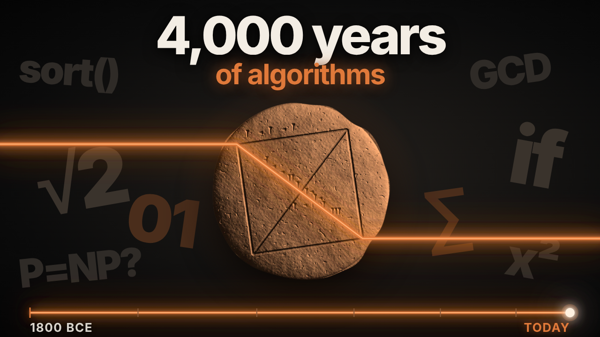

# Timelapse of Algorithms

{ width="560" }

**Episode length:** about 12 minutes · **Suggested level:** grades 7 to 12, intro college · **Subjects:** math, history, computer science

[:material-youtube: Watch the episode](VIDEO_URL){ .md-button .md-button--primary } [:material-file-pdf-box: Download the PDF](../pdf/timelapse-of-algorithms.pdf){ .md-button }

## In one paragraph

An algorithm is a finite list of steps that solves a problem. This episode follows that idea for about 4,000 years. It starts with a Babylonian clay tablet that gives the square root of two and Egyptian scribes who multiplied by doubling. It moves through Euclid, Archimedes, Liu Hui, Aryabhata and al-Khwarizmi, whose name became the word "algorithm." Then the steps move into machines, from Jacquard's punched-card loom and Ada Lovelace's Note G to Turing, ENIAC and Grace Hopper's compiler. It ends with the algorithms that run today's world, from shortest routes and sorting to search and machine learning.

## Watch with chapters

| Time | Chapter | What to look for |
|---|---|---|
| 0:00 | Before there were machines | What makes a set of steps an algorithm |
| 0:41 | 1. Clay and Papyrus | The square root of two in clay, and multiplying by doubling |
| 2:17 | 2. Proof and Approximation | Euclid, Archimedes, Liu Hui and Aryabhata |
| 4:08 | 3. The Name | al-Khwarizmi, Fibonacci and the Maya Venus table |
| 6:00 | 4. Pattern and Thread | Chokwe *sona*, binary, the Jacquard loom and Ada Lovelace |
| 7:43 | 5. Logic and Machines | Boole, Hollerith, Turing, ENIAC and Grace Hopper |
| 9:38 | 6. Search and Learning | Dijkstra, Quicksort, P versus NP, the Perceptron, PageRank and AlexNet |
| 11:17 | A line in the sand | What has and hasn't changed |

## Timeline

| When | Where | What happened |
|---|---|---|
| c. 1800–1600 BCE | Mesopotamia | A school tablet (YBC 7289) gives the square root of two to about six decimal places, written in base sixty. |
| c. 1550 BCE | Egypt | The scribe Ahmes copies the Rhind Mathematical Papyrus, a workbook of problems and the steps to solve them. |
| c. 300 BCE | Alexandria | Euclid's *Elements*, Book VII, describes how to find the greatest common divisor of two numbers. |
| c. 250 BCE | Syracuse | Archimedes traps pi between 3 10/71 and 3 1/7 using polygons with up to 96 sides. |
| 263 CE | China | Liu Hui's commentary on the *Nine Chapters* pushes the polygon method past 3,000 sides and gives pi as 3.1416. |
| 499 CE | India | Aryabhata's *Aryabhatiya* includes the method later called *kuttaka*, "the pulverizer." |
| c. 825 CE | Baghdad | Muhammad ibn Musa al-Khwarizmi writes on calculating with the Indian numerals, including zero. |
| 1100s | Europe | A Latin translation opens "*Dixit Algorizmi*," "so says al-Khwarizmi." His name becomes *algorism*, then *algorithm*. |
| 1202 | Pisa | Leonardo of Pisa (Fibonacci) teaches the new numerals to European traders in *Liber Abaci*. |
| c. 1200s | Maya world | The Dresden Codex Venus table tracks Venus and builds in corrections to stay accurate. |
| Long-standing | Northeastern Angola | Chokwe storytellers draw *sona*, rule-based line drawings in the sand. |
| 1679–1703 | Germany | Gottfried Wilhelm Leibniz writes every number with only 1 and 0. |
| 1804 | Lyon | Joseph Marie Jacquard's loom is controlled by a chain of punched cards. |
| 1843 | London | Ada Lovelace's Note G sets out how the Analytical Engine could calculate Bernoulli numbers. |
| 1854 | Cork | George Boole shows that logic can be written as algebra. |
| 1890 | United States | Herman Hollerith's punched-card machines tabulate the census. |
| 1936 | Cambridge | Alan Turing defines what it means for a problem to be computable. |
| 1941 | Ottawa | Canada opens the Examination Unit to break enemy codes. |
| 1945 | Philadelphia | Six women program ENIAC by setting switches and plugging cables. |
| 1952 | United States | Grace Hopper builds one of the first compilers. |
| 1956 | Amsterdam | Edsger Dijkstra works out a shortest-path method. |
| 1958 | Cornell | Frank Rosenblatt builds the Perceptron, a machine that learns from examples. |
| 1959 | Moscow | Tony Hoare invents Quicksort. |
| 1971 | Toronto | Stephen Cook poses the question now called P versus NP. |
| 1998 | Stanford | Larry Page and Sergey Brin describe PageRank. |
| 2012 | Toronto | AlexNet, by Krizhevsky, Sutskever and Hinton, starts the deep learning era. |
| 2024 | Stockholm | John Hopfield and Geoffrey Hinton share the Nobel Prize in Physics. |

## Key terms

Algorithm
:   A finite list of clear steps that solves a problem. Anyone who follows the steps gets the same result.

Loop
:   A step, or group of steps, that repeats until a condition is met. The Babylonian square-root method is a loop: guess, divide, average and repeat.

Base sixty
:   A number system that counts in groups of sixty. We still use it for minutes, seconds and the degrees in a circle.

Greatest common divisor
:   The largest number that divides two other numbers with nothing left over. Euclid's method finds it.

Approximation
:   An answer that gets closer and closer to the true value without reaching it exactly, like Archimedes' bounds on pi.

Place value
:   A system where a digit's position sets its value. In 305, the 3 means three hundreds because of where it sits.

Binary
:   A number system that uses only two digits, 1 and 0. Modern computers store everything this way.

Compiler
:   A program that turns instructions written for people into code a machine can run.

Computable
:   A problem is computable if some algorithm can always solve it. Turing proved that some problems are not.

Neural network
:   A program made of many simple connected units that adjusts its own settings by learning from examples.

## Primary sources and places to visit online

Each name below is a link to the institution that holds the object or published the original work. Extra links follow after "Also". Links were checked on 30 October 2026. If one breaks, search the name on the institution's site.

### 1. Clay and Papyrus

- **[YBC 7289, the square-root-of-two tablet](https://isaw.nyu.edu/exhibitions/before-pythagoras/items/ybc-7289)**, Yale Babylonian Collection. Also: [catalogue record and photos (CDLI)](https://cdli.earth/artifacts/255048)
- **[The Rhind Mathematical Papyrus](https://www.britishmuseum.org/collection/object/Y_EA10057)**, British Museum, London.

### 2. Proof and Approximation

- **[A papyrus fragment of Euclid's *Elements*](https://penn.museum/collections/object/63505)** (Papyrus Oxyrhynchus 29, about 100 CE), Penn Museum, Philadelphia.
- **[The Archimedes Palimpsest](https://archimedespalimpsest.org/)**, a medieval copy of Archimedes' works, including texts found nowhere else, recovered with special imaging.
- **Aryabhata's *Aryabhatiya*.** An English translation by W. E. Clark (1930) is in the public domain. Search Wikisource or the Internet Archive for "The Aryabhatiya of Aryabhata."

### 3. The Name

- **[The "*Dixit Algorizmi*" manuscript](https://cudl.lib.cam.ac.uk/view/MS-II-00006-00005/1)**, the Latin al-Khwarizmi text, Cambridge University Library, MS Ii.6.5.
- **[The Dresden Codex](https://www.loc.gov/item/2021667917/)**, including the Venus table. Full digital copy via the Library of Congress. The original is at the Saxon State and University Library, Dresden.

### 4. Pattern and Thread

- **Chokwe *sona*.** Paulus Gerdes, *Geometry from Africa: Mathematical and Educational Explorations* (Mathematical Association of America, 1999). Please read the note on cultural respect below before teaching this section.
- **[Leibniz, "Explication de l'Arithmétique Binaire" (1703)](https://journals.openedition.org/bibnum/553)**, annotated edition with facsimile, BibNum (in French).
- **[The Jacquard hand loom](https://collection.sciencemuseumgroup.org.uk/objects/co8405056)**, Science Museum Group, UK. Also: [Jacquard punched cards](https://collection.sciencemuseumgroup.org.uk/objects/co503962)
- **[Babbage's Analytical Engine, trial model](https://collection.sciencemuseumgroup.org.uk/objects/co62245)**, Science Museum Group.
- **[Ada Lovelace's papers online](https://claymath.org/news/ada-lovelace-online)**, Clay Mathematics Institute. Also: [Bodleian Libraries blog on Lovelace's papers](https://blogs.bodleian.ox.ac.uk/adalovelace/)

### 5. Logic and Machines

- **[George Boole, *An Investigation of the Laws of Thought* (1854)](https://www.gutenberg.org/ebooks/15114)**, free full text, Project Gutenberg.
- **[Hollerith's tabulating machine](https://www.si.edu/object/nmah_694410)**, Smithsonian National Museum of American History.
- **[Alan Turing's 1936 machine](https://turing.org.uk/scrapbook/machine.html)**, The Alan Turing Internet Scrapbook, by biographer Andrew Hodges.
- **[The Examination Unit (1941–1945)](https://www.canada.ca/en/parks-canada/news/2021/08/the-examination-unit-19411945.html)**, Parks Canada. Also: [Communications Security Establishment: Our story](https://cse-cst.gc.ca/en/culture-and-community/history/our-story)
- **[An ENIAC accumulator panel](https://www.si.edu/object/nmah_334742)**, Smithsonian National Museum of American History.
- **[Grace Hopper completes the A-0 compiler](https://www.computinghistory.org.uk/det/5487/Grace-Hopper-completes-the-A-0-Compiler/)**, Centre for Computing History.

### 6. Search and Learning

- **[Dijkstra (1959), "A note on two problems in connexion with graphs"](https://link.springer.com/doi/10.1007/BF01386390)**, *Numerische Mathematik*.
- **[Stephen Cook and "The Complexity of Theorem-Proving Procedures" (1971)](https://www.heidelberg-laureate-forum.org/laureate/stephen-a-cook/)**, Heidelberg Laureate Forum profile.
- **[Rosenblatt's Perceptron](https://news.cornell.edu/node/313946)**, Cornell Chronicle: "Professor's perceptron paved the way for AI – 60 years too soon."
- **[Brin and Page (1998), the paper that introduced Google and PageRank](https://stanford.io/2Xz7Khb)**, Stanford.
- **[Krizhevsky, Sutskever and Hinton (2012), the AlexNet paper](https://papers.nips.cc/paper/2012/hash/c399862d3b9d6b76c8436e924a68c45b-Abstract.html)**, NeurIPS proceedings.
- **[The 2024 Nobel Prize in Physics](https://www.nobelprize.org/prizes/physics/2024/press-release/)**, Nobel Prize press release.

### The whole episode

- **[Revolution: The First 2000 Years of Computing](https://computerhistory.org/exhibits/revolution/)**, an online exhibit from the Computer History Museum.

## Hands-on activity: multiply like an Egyptian scribe

**Time:** 15 minutes · **Materials:** paper and pencil

1. Pick two numbers, for example 12 × 13.
2. Make two columns. Start the left column at 1 and the right column at the first number (12).
3. Double both columns on each new row: 1 and 12, 2 and 24, 4 and 48, 8 and 96. Stop before the left column passes the second number (13).
4. Find the left-column numbers that add up to the second number: 1 + 4 + 8 = 13. Tick those rows.
5. Add the right-column numbers on the ticked rows: 12 + 48 + 96 = 156. That's the answer.

**Follow-up questions**

- Why can every whole number be built from 1, 2, 4, 8, 16 and so on, each used at most once?
- Write 13 in binary (1101). How do the ticked rows match the 1s?
- Is this method an algorithm? Point to the steps, the loop and the stopping rule.

**Extension:** try Euclid's method on 84 and 36. Take the smaller from the larger and repeat with what's left until the two numbers match. You should reach 12.

## Discussion questions

1. The episode says an algorithm is "a finite list of steps that solves a problem." Which examples in the video fit that definition best? Do any stretch it?
2. Why do you think written calculation on paper slowly beat the abacus in Europe, even though the abacus was fast?
3. Ada Lovelace is "often called" the first programmer. Why might historians choose those words carefully?
4. The ENIAC programmers were left out of the story for decades. What does it change when we learn their names?
5. Turing proved that some problems can't be solved by any algorithm. Why might that be a useful thing to know?

## What's still debated

- **How the Babylonian scribe found √2.** We have the answer on the tablet but not the working. The "guess, divide, average" loop is one method often linked to Babylon. It isn't proven to be the one used.
- **Who counts as "the first programmer."** Lovelace's Note G is a clear step-by-step program for a machine. Some historians point out that Babbage had written earlier examples for the same engine.
- **P versus NP.** Nobody knows yet whether every problem that's easy to check is also easy to solve. It's one of the biggest open questions in mathematics.

## A note on cultural respect

The Chokwe *sona* tradition and the Maya Dresden Codex belong to living cultures. Present them as knowledge systems in their own right, not as early versions of European mathematics. Where you can, use sources written by or with members of those communities.

## Further reading

- Jean-Luc Chabert (ed.), *A History of Algorithms: From the Pebble to the Microchip* (Springer, 1999).
- Eleanor Robson, *Mathematics in Ancient Iraq: A Social History* (Princeton University Press, 2008).
- Kathy Kleiman, *Proving Ground: The Untold Story of the Six Women Who Programmed the World's First Modern Computer* (Grand Central, 2022).

## Credits and reuse

Study guide by Slow Centuries. Text is shared under a [Creative Commons Attribution 4.0 licence](https://creativecommons.org/licenses/by/4.0/). You may copy, adapt and share it, including in class and on school websites, as long as you credit "Slow Centuries." Linked objects and images belong to the institutions that hold them and follow their own terms.

Found an error or a broken link? [Tell us on GitHub](https://github.com/GITHUB_USER/slow-centuries-study-guides/issues).
