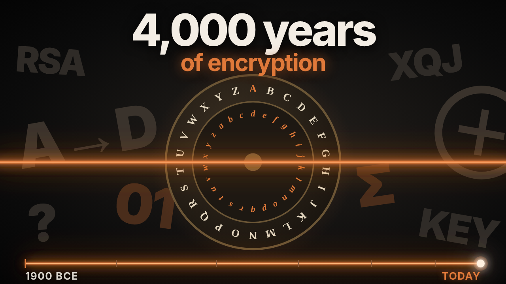

# Timelapse of Encryption

{ width="560" }

**Episode length:** about 11 minutes · **Suggested level:** grades 7 to 12, intro college · **Subjects:** history, math, computer science

[:material-youtube: Watch the episode](VIDEO_URL){ .md-button .md-button--primary } [:material-file-pdf-box: Download the PDF](../pdf/timelapse-of-encryption.pdf){ .md-button }

## In one paragraph

Every secret starts the same way: two people want to talk, and a third is listening. This episode follows the race between hiding messages and reading them. It starts with unusual hieroglyphs in an Egyptian tomb, the Spartan scytale and Caesar's shift. In Baghdad, al-Kindi counts letters and breaks simple ciphers. Europe answers with cipher disks, keywords and black chambers. The telegraph and two world wars bring codebooks, the one-time pad, Enigma and the first electronic computers. Since 1976, public keys let strangers share secrets over open lines, and today new methods are being made standard to resist quantum computers.

## Watch with chapters

| Time | Chapter | What to look for |
|---|---|---|
| 0:00 | Two people want to talk | The listener in the middle |
| 0:10 | 1. Hidden in Plain Sight | Beni Hasan, a secret glaze recipe, the scytale and Caesar's shift |
| 1:42 | 2. The Codebreaker | al-Kindi and frequency analysis |
| 2:41 | 3. Courts and Ciphers | Alberti's disk, the indecipherable cipher, Mary Queen of Scots and the Great Cipher |
| 4:39 | 4. Wires and War | The telegraph, Playfair, Kasiski, Room 40 and the one-time pad |
| 6:10 | 5. Machines | Enigma, the Polish Cipher Bureau, Bletchley Park, Ottawa and the Navajo code talkers |
| 8:12 | 6. Public Keys | Diffie and Hellman, RSA, GCHQ, PGP, AES and quantum-safe standards |
| 10:16 | The long silence, still being kept | What hasn't changed |

## Timeline

| When | Where | What happened |
|---|---|---|
| c. 1900 BCE | Beni Hasan, Egypt | A scribe carves a tomb inscription with unusual hieroglyphs in place of the common ones. |
| c. 1500 BCE | Mesopotamia | A clay tablet records a pottery-glaze recipe in an obscure, shortened way. |
| c. 400 BCE | Sparta | Writers describe the scytale, a strip of leather wound round a rod. |
| c. 50 BCE | Rome | Julius Caesar shifts every letter three places. Augustus shifts by one. |
| 800s CE | Baghdad | al-Kindi writes the first known method for breaking a cipher: frequency analysis. |
| 1467 | Rome | Leon Battista Alberti describes a cipher disk with two rings of letters. |
| 1553 | Italy | Giovan Battista Bellaso uses a keyword to choose the alphabet for each letter. |
| 1586 | England | Mary, Queen of Scots, writes in cipher. Thomas Phelippes reads every letter. |
| 1600s | France | Antoine and Bonaventure Rossignol build the Great Cipher for Louis XIV. |
| 1840s | Worldwide | The electric telegraph carries messages through operators who can read them. |
| 1854 | Britain | Charles Wheatstone invents a cipher that scrambles letters in pairs: the Playfair cipher. |
| 1863 | Prussia | Friedrich Kasiski publishes how to find the length of a Vigenère keyword. |
| 1890s | France | Étienne Bazeries cracks the Great Cipher. |
| 1917 | London | Room 40 deciphers the Zimmermann Telegram. |
| 1917 | United States | Gilbert Vernam combines a message with a random key tape: the one-time pad. |
| 1920s | Germany | The Enigma machine scrambles each keystroke through rotating wheels. |
| 1932 | Warsaw | Rejewski, Różycki and Zygalski rebuild Enigma's wiring using mathematics. |
| 1939 | Bletchley Park | Alan Turing and Gordon Welchman design the bombe. |
| 1941 | Ottawa | Canada's Examination Unit starts breaking enemy codes. |
| 1942 | Pacific | The first twenty-nine Navajo recruits build a code that is never broken. |
| 1944 | Bletchley Park | Tommy Flowers builds Colossus, among the first programmable electronic computers. |
| 1949 | United States | Claude Shannon publishes the mathematics of secrecy. |
| 1976 | Stanford | Whitfield Diffie and Martin Hellman publish the idea of public keys. |
| 1977 | MIT | Rivest, Shamir and Adleman build RSA. |
| 1997 | Britain | GCHQ reveals that Ellis, Cocks and Williamson found the same ideas earlier, in secret. |
| 1990s | Worldwide | PGP brings encryption to ordinary email; browsers lock their connections. |
| 2001 | United States | The U.S. adopts AES. |
| 2024 | United States | NIST publishes the first standards meant to resist quantum computers. |

## Key terms

Cipher
:   A method for scrambling letters or symbols so that only someone with the key can read the message.

Code
:   A system that swaps whole words or phrases for other words, numbers or symbols, often using a codebook.

Key
:   The secret that unlocks a message, like the shift in Caesar's cipher or the keyword in Vigenère's.

Substitution cipher
:   A cipher that replaces each letter with another letter or symbol.

Frequency analysis
:   Breaking a cipher by counting which symbols appear most often and matching them to the most common letters.

Keyword cipher
:   A cipher that uses a word to choose a different alphabet for each letter, so one letter can be hidden many ways.

One-time pad
:   A cipher that uses a random key as long as the message, used only once. It can be proven unbreakable.

Rotor machine
:   A machine, like Enigma, whose turning wheels change the cipher with every keystroke.

Public key
:   A "padlock" anyone can use to lock a message. Only the matching private key can open it.

Factoring
:   Finding the smaller numbers that multiply to make a large number. RSA relies on how hard this is.

## Hands-on activity: make and break a Caesar cipher

**Time:** 20 minutes · **Materials:** paper, scissors, a pin or paper fastener

1. Cut two paper circles, one slightly smaller than the other. Write A to Z around the edge of each.
2. Pin them together at the centre so the inner circle can turn.
3. Turn the inner circle three places so A sits under D. Write a short message using your wheel.
4. Swap messages with a partner. Without telling them the shift, ask them to break it.
5. Count the letters in a longer coded message. Match the most common symbol to E, then T and A, and see how quickly the message falls apart.

**Follow-up questions**

- Why is a Caesar cipher so easy to break once you know about frequency analysis?
- How does Alberti's idea of turning the disk during a message make frequency analysis harder?
- Why does the episode call the history of secrets "a race"?

**Extension:** encrypt "ATTACK AT DAWN" with the keyword LEMON using a Vigenère square. You should get LXFOPVEFRNHR.

## Discussion questions

1. The episode says encryption separates the method from the message. Why does that matter?
2. Mary, Queen of Scots, trusted her cipher. What went wrong?
3. GCHQ found public-key ideas first but kept them secret. What are the costs and benefits of secret research?
4. In the 1990s, strong encryption counted as a weapon under U.S. export law. Should ordinary people have strong encryption?
5. Every message you send today is encrypted. Who is the "third person listening" now?

## What's still debated

- **How the scytale was really used.** Ancient writers describe it, but historians still debate whether it hid messages or simply checked that they were genuine.
- **Whether Beni Hasan counts as encryption.** The unusual hieroglyphs changed symbols on purpose, but probably as a flourish, not real secrecy.
- **When quantum computers will matter.** Nobody knows yet when they could break today's public-key systems. New standards are being adopted before that happens.

## A note on cultural respect

The Navajo code was built from the Navajo language, which is a living language spoken today. Present the code talkers as Navajo servicemembers whose language and skill made the code possible, and use sources from the Navajo Nation and Native-led institutions where you can.

## Primary sources and places to visit online

Each name below is a link to the institution that holds the object or published the original work. Extra links follow after "Also". Links were checked on 30 October 2026. If one breaks, search the name on the institution's site.

### 3. Courts and Ciphers

- **[Ciphers used by Mary Queen of Scots](https://www.nationalarchives.gov.uk/education/resources/elizabeth-monarchy/ciphers-used-by-mary-queen-of-scots/)**, The National Archives (UK), classroom resource.

### 4. Wires and War

- **[The Zimmermann Telegram](https://www.archives.gov/milestone-documents/zimmermann-telegram)**, U.S. National Archives. Also: [Decode worksheet for the Zimmermann Telegram](https://www.docsteach.org/documents/document/zimmermann-telegram-decode-worksheet)

### 5. Machines

- **[A four-rotor Enigma cipher machine](https://collection.sciencemuseumgroup.org.uk/objects/co64128/four-rotor-enigma-cypher-machine-1939-45)**, Science Museum Group, UK.
- **[The Turing-Welchman Bombe](https://www.tnmoc.org/bombe)**, The National Museum of Computing, Bletchley Park. Also: [Colossus](https://www.tnmoc.org/colossus)
- **[The Examination Unit (1941–1945)](https://www.canada.ca/en/parks-canada/news/2021/08/the-examination-unit-19411945.html)**, Parks Canada. Also: [Communications Security Establishment: Our story](https://cse-cst.gc.ca/en/culture-and-community/history/our-story)
- **[Navajo Code Talkers](https://www.usmcmuseum.com/distance-learning-navajo-code-talkers.html)**, National Museum of the Marine Corps, distance learning.

### 6. Public Keys

- **[James Ellis](https://www.gchq.gov.uk/person/james-ellis)**, GCHQ. Also: [Malcolm Williamson](https://www.gchq.gov.uk/person/malcolm-williamson)
- **[NIST releases the first finalized post-quantum encryption standards](https://www.nist.gov/news-events/news/2024/08/nist-releases-first-3-finalized-post-quantum-encryption-standards)**, National Institute of Standards and Technology, August 2024.

## Further reading

- Simon Singh, *The Code Book* (Fourth Estate, 1999).
- David Kahn, *The Codebreakers* (Macmillan, 1967).

## Credits and reuse

Study guide by Slow Centuries. Text is shared under a [Creative Commons Attribution 4.0 licence](https://creativecommons.org/licenses/by/4.0/). You may copy, adapt and share it, including in class and on school websites, as long as you credit "Slow Centuries." Linked objects and images belong to the institutions that hold them and follow their own terms.

Found an error or a broken link? [Tell us on GitHub](https://github.com/GITHUB_USER/slow-centuries-study-guides/issues).
