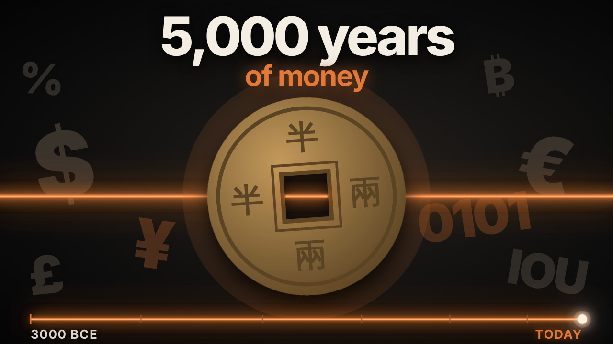

# Timelapse of Money

{ width="560" }

**Episode length:** about 11 minutes · **Suggested level:** grades 7 to 12, intro college · **Subjects:** history, economics, social studies

[:material-youtube: Watch the episode](VIDEO_URL){ .md-button .md-button--primary } [:material-file-pdf-box: Download the PDF](../pdf/timelapse-of-money.pdf){ .md-button }

## In one paragraph

Money began as a record of who owes what. In Mesopotamia, scribes pressed debts into clay and measured value in shekels of barley and silver. In Lydia, someone stamped lumps of electrum, and the coin was born. China moved to paper, first as "flying money" receipts and then as notes issued by the Song government. Italian bankers kept double-entry books, and banks in Amsterdam, Stockholm and London turned paper into a system tied to the state and later to gold. After 1971, money rested on law, institutions and trust. Today most of it lives as entries in bank ledgers, sent by card, phone and network.

## Watch with chapters

| Time | Chapter | What to look for |
|---|---|---|
| 0:00 | Before there was money | A debt pressed into clay |
| 0:29 | 1. Debts Before Coins | Shekels, storehouses, Hammurabi's interest limits and cowrie shells |
| 1:59 | 2. Metal | Lydian electrum, Croesus, the Athenian owl, the Qin coin and Rome's mint |
| 3:52 | 3. Paper and Promises | Flying money, the jiaozi, inflation, bills of exchange and double entry |
| 5:40 | 4. Banks and States | Amsterdam, Stockholm, the Bank of England, John Law and the gold standard |
| 7:21 | 5. The Century of Trust | Bretton Woods, 15 August 1971, cards, cash machines and SWIFT |
| 8:52 | 6. Money Becomes Data | M-Pesa, Bitcoin and digital currencies |
| 10:06 | A debt, still being written | What money has always been |

## Timeline

| When | Where | What happened |
|---|---|---|
| c. 3000 BCE | Mesopotamia | In cities like Uruk, temples and palaces store the harvest, lend it out and keep accounts. |
| c. 2500 BCE | Mesopotamia | The shekel is a unit of weight, of barley and later of silver. Sixty shekels make a mina. |
| c. 1754 BCE | Babylon | Hammurabi's laws limit interest: twenty percent a year on silver and a third on grain. |
| Centuries | Africa and Asia | Cowrie shells from the Maldives travel the trade routes as money. |
| c. 600 BCE | Lydia | Lumps of electrum, a natural mix of gold and silver, are stamped with a lion's head. |
| 500s BCE | Lydia | King Croesus issues coins of pure gold and pure silver. |
| 400s BCE | Athens | Greek cities strike their own silver coins. Athens chooses an owl. |
| 221 BCE | China | The Qin dynasty sets one standard coin: round, bronze, with a square hole. |
| 200s CE | Rome | Coins are made at the temple of Juno Moneta. Emperors stretch the silver until a coin holds only a few percent. |
| 800s CE | Tang China | Merchants use "flying money," paper receipts cashed in another city. |
| 1020s | Sichuan | Deposit shops issue *jiaozi* notes; the Song government takes over issuing them. |
| 1200s | Yuan China | Too many notes lead to rising prices. Marco Polo describes the emperor's paper money. |
| 1200s | Italy | A bill of exchange lets a merchant in Florence pay a supplier in Bruges. |
| 1400s | Europe | Bankers keep double-entry books; the Medici run branches from London to Rome. |
| 1494 | Italy | Luca Pacioli explains double entry in a printed book. |
| 1609 | Amsterdam | The city opens an exchange bank; merchants pay by transfer. |
| 1661 | Stockholm | A bank issues some of the first banknotes in Europe, then fails. |
| 1694 | London | The Bank of England is set up to fund a war; its first loan is £1.2 million. |
| 1716–1720 | Paris | John Law backs paper money with Mississippi Company shares. The bubble bursts. |
| 1700s–1800s | Britain | Britain moves to a gold standard; much of the world follows. |
| 1944 | Bretton Woods | 44 nations peg their currencies to the dollar, and the dollar to gold at $35 an ounce. |
| 1950 | United States | The Diners Club card lets members pay now and settle later. |
| 1958 | California | Bank of America mails out a card that later grows into Visa. |
| 1967 | Enfield, London | One of the world's first cash machines opens outside a Barclays branch. |
| 1971 | United States | On 15 August, the U.S. stops converting dollars into gold. Major currencies float. |
| 1973 | International | Banks in fifteen countries create SWIFT, a network for payment messages. |
| 2007 | Kenya | M-Pesa lets people send money by text message. |
| 2008 | Online | A white paper signed "Satoshi Nakamoto" proposes Bitcoin. |
| 2020 | The Bahamas | The Sand Dollar, one of the first digital currencies issued by a central bank to a whole country. |

## Key terms

Debt
:   Something owed by one person to another. The episode starts with a debt of barley pressed into clay.

Shekel
:   A Mesopotamian unit of weight, first of barley and later of silver. Prices, wages and fines were counted in shekels.

Interest
:   An extra amount a borrower pays for a loan. Hammurabi's laws set limits on it.

Electrum
:   A natural mix of gold and silver, used for the first Lydian coins.

Inflation
:   A general rise in prices. It happens when too much money chases too few goods.

Bill of exchange
:   A written order to pay someone a sum of money, so coins don't have to travel.

Double entry
:   A way of keeping accounts where every amount is written down twice, once where it comes from and once where it goes.

Banknote
:   A printed paper note that can be handed from person to person as money.

Gold standard
:   A system where each note is a claim on a fixed weight of gold held in a vault.

Floating currency
:   A currency whose value is set by markets instead of being pegged to gold or another currency.

Ledger
:   A record of accounts. Today most money exists as entries in bank ledgers.

## Hands-on activity: keep a double-entry ledger

**Time:** 15 minutes · **Materials:** paper, pencil and a ruler

1. Draw three columns and label them: what happened, debit (where the value goes) and credit (where it comes from).
2. Your class runs a small market stall. Record these three events: you buy 10 loaves for $20, you sell 6 loaves for $18, and you lend a friend $5.
3. Write each event twice, once in each column. For example, buying loaves is a debit to "stock" and a credit to "cash."
4. Add up both columns. If the totals match, your books balance.
5. Swap ledgers with a partner and check each other's work.

**Follow-up questions**

- Why would writing every amount twice make mistakes easier to spot?
- How is your ledger like the clay tablet at the start of the episode?
- Where are the ledgers that record your family's money kept today?

**Extension:** look at a Babylonian tablet or a Bank of England banknote online (see the sources below). What information does it record?

## Discussion questions

1. The episode says money is "a record that strangers agree to trust." What makes you trust a coin, a note or a number on a screen?
2. Why might the stamp on a coin matter more than the metal inside it?
3. Several banks in this story issued more notes than they could repay. What happens to trust when that's found out?
4. What changed after 15 August 1971, and what stayed the same?
5. Who keeps the record of your money today, and why do you believe it?

## What's still debated

- **Whether Bitcoin counts as money in the full sense.** People still argue about it. The episode leaves the question open.
- **When the first coins were made.** "About 2,600 years ago" in Lydia is a safe date, but historians debate the exact decade and how widely the first coins were used.
- **Central bank digital currencies.** Central banks are still studying them, and countries are making different choices.

## Primary sources and places to visit online

Each name below is a link to the institution that holds the object or published the original work. Extra links follow after "Also". Links were checked on 30 October 2026. If one breaks, search the name on the institution's site.

### 1. Debts Before Coins

- **[A stele fragment inscribed with Hammurabi's Code](https://collections.louvre.fr/en/ark:/53355/cl010188648)**, Louvre, Paris. The full law stele is also in the Louvre.

### 2. Metal

- **[A Lydian electrum coin with a lion's head](https://www.britishmuseum.org/collection/object/C_RPK-p146C-1-Sam)**, 6th century BCE, British Museum, London.
- **[A silver tetradrachm with Athena and the owl](https://www.metmuseum.org/ko/art/collection/search/254721)**, 450–420 BCE, The Metropolitan Museum of Art, New York.

### 3. Paper and Promises

- **[One of the world's first banknotes](https://idp.bl.uk/blog/one-of-the-worlds-first-banknotes/)**, International Dunhuang Programme, British Library.
- **[Printing and the state: the first paper money](https://www.cabinet.ox.ac.uk/node/6959)**, Heberden Coin Room, Ashmolean Museum, Oxford.

### 4. Banks and States

- **[1661: First banknotes in Europe](https://www.riksbank.se/en-gb/about-the-riksbank/history/historical-timeline/1600-1699/first-banknotes-in-europe/)**, Sveriges Riksbank.
- **[The Bank of England's founding documents](https://www.bankofengland.co.uk/museum/online-collections/archive-gallery/founding-documents)**, Bank of England Museum. Also: [Why was the Bank of England founded?](https://www.bankofengland.co.uk/museum/online-collections/blog/why-was-the-bank-of-england-founded) · [Our earliest Bank of England note](https://www.bankofengland.co.uk/museum/online-collections/blog/our-earliest-bank-of-england-note)

### 5. The Century of Trust

- **[Creation of the Bretton Woods system](https://www.federalreservehistory.org/essays/bretton-woods-created)**, Federal Reserve History.
- **[Nixon ends convertibility of U.S. dollars to gold](https://www.federalreservehistory.org/essays/gold-convertibility-ends)**, Federal Reserve History.

### 6. Money Becomes Data

- **[Bitcoin: A Peer-to-Peer Electronic Cash System](https://bitcoin.org/bitcoin.pdf)**, the 2008 white paper signed "Satoshi Nakamoto."

## Further reading

- Felix Martin, *Money: The Unauthorised Biography* (Bodley Head, 2013).
- Glyn Davies, *A History of Money* (University of Wales Press, fourth edition 2016).

## Credits and reuse

Study guide by Slow Centuries. Text is shared under a [Creative Commons Attribution 4.0 licence](https://creativecommons.org/licenses/by/4.0/). You may copy, adapt and share it, including in class and on school websites, as long as you credit "Slow Centuries." Linked objects and images belong to the institutions that hold them and follow their own terms.

Found an error or a broken link? [Tell us on GitHub](https://github.com/GITHUB_USER/slow-centuries-study-guides/issues).
